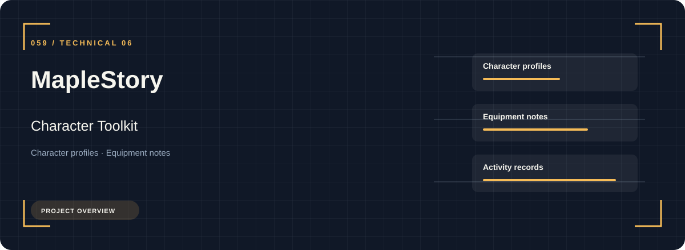
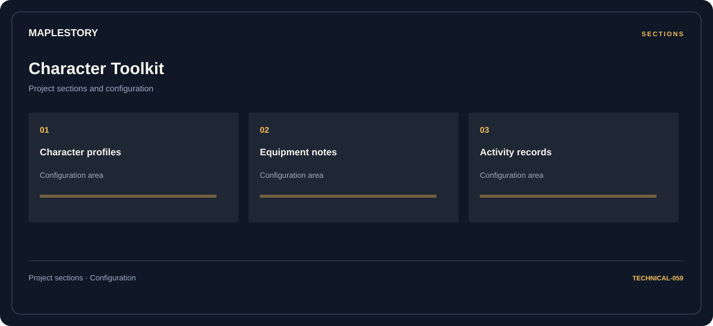

# 🧭 MapleStory Character Toolkit

**Character profiles · Equipment notes · Activity records**

## ⚡ Features

Character profiles, equipment notes, and activity records form the core of MapleStory Character Toolkit. Related configuration is grouped by task rather than collected in an undifferentiated list.

### ⚙️ Character profiles

Related settings collected into named groups for a clearer configuration workflow.

### 🧩 Equipment notes

Equipment categories and the associated selection or configuration options.

### ⌨️ Activity records

Session and activity information grouped by the task or context it belongs to.

## 🖥️ Project navigation

## 📥 Download

The button and cover open the project's download page. Use the information supplied with the downloaded package for installation and release-specific requirements.

## 📚 Project documentation

- [Feature reference](docs/FEATURES.md)
- [Download information](docs/DOWNLOAD.md)
- [Project page](index.html)

---

MapleStory Character Toolkit · Program documentation and download information.
